# VELOR — Velvet Cold Coffee

**A cinematic, scroll-driven brand site plus a restaurant dashboard, built entirely on the frontend.**

The public site scrubs a 267-frame video of an iced latte on a canvas as you scroll,
with real HTML text choreographed on the same timeline. Behind it, an `/admin` dashboard
lets the café manage orders, menu and opening hours. Every change shows up live on the
public site, through a typed REST API served by a mock service worker. No backend required.

> Fictional brand (Paris 11e). Demo login: `demo@velor.example` / `velor-demo`. This is not
> real authentication.

     

<p align="center">
  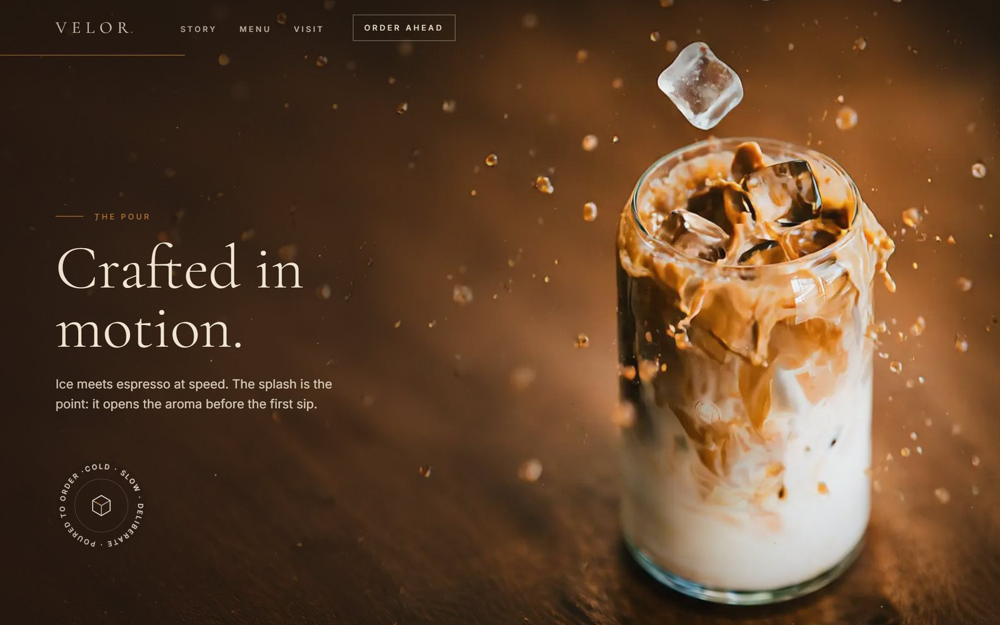
</p>

<p align="center"><b><a href="https://velora-rho-lyart.vercel.app/">Live site</a></b> · <a href="https://velora-rho-lyart.vercel.app/admin/login">Dashboard</a></p>

---

## Screenshots

### Brand website

| Hero | Our Story |
|---|---|
| 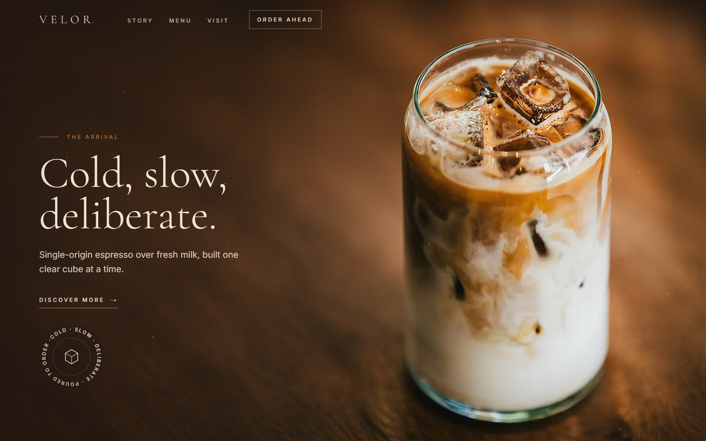 | 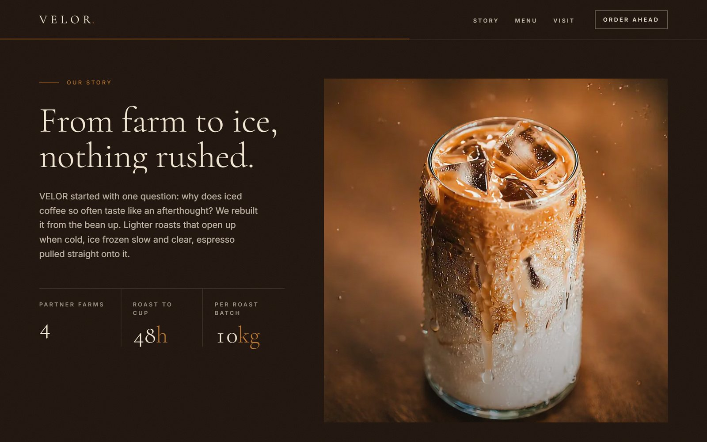 |
| **Menu** | **Visit** |
| 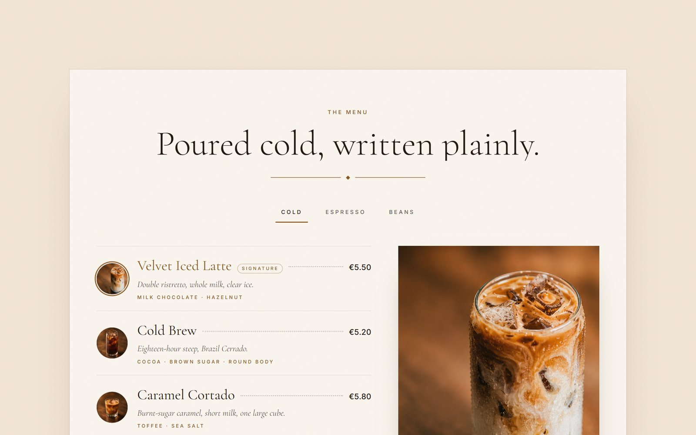 | 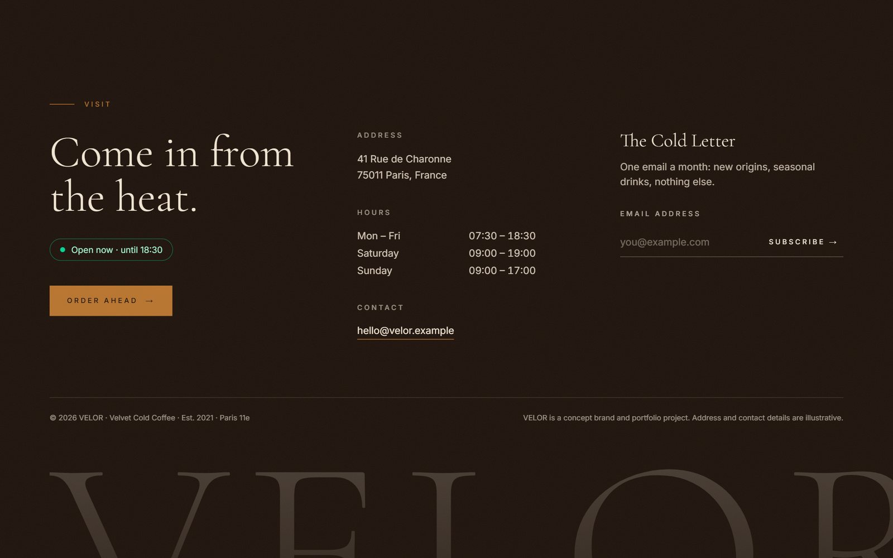 |

### Operations dashboard

| Overview | Orders board |
|---|---|
| 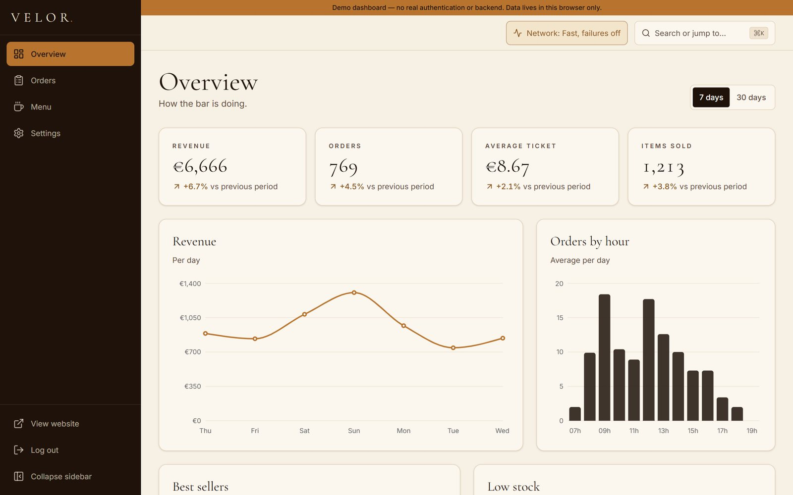 | 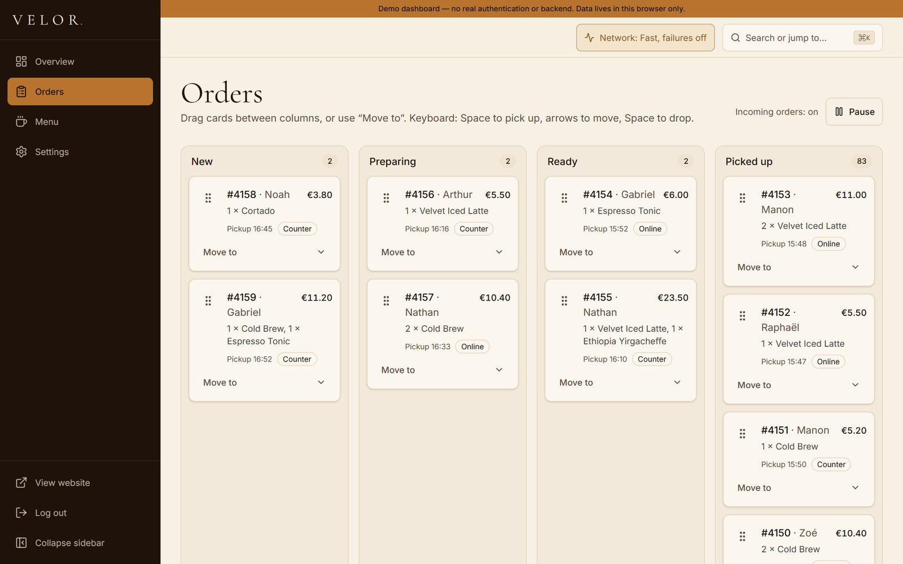 |
| **Menu management** | **Opening hours** |
| 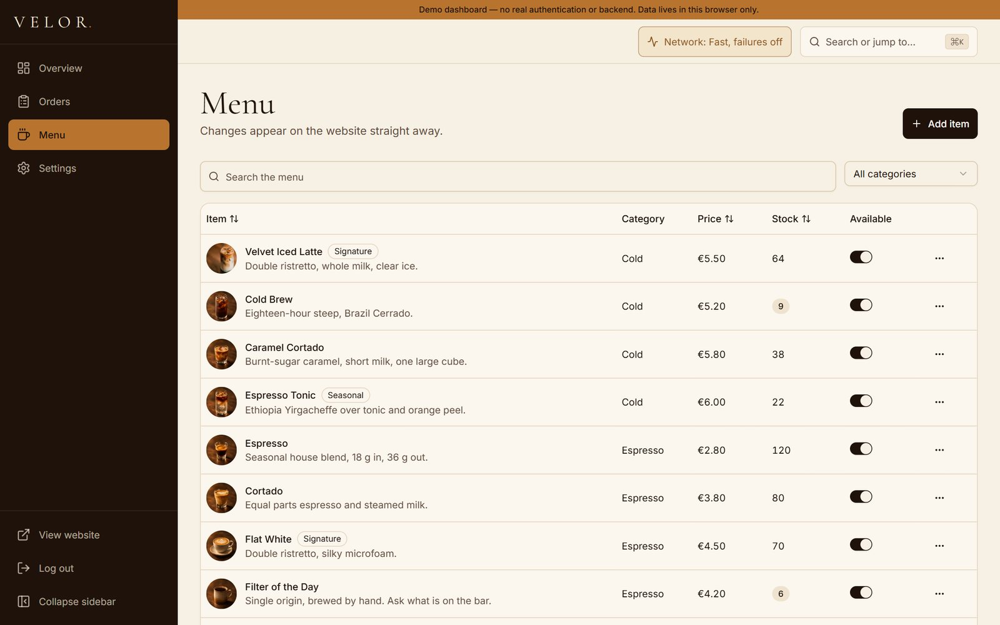 | 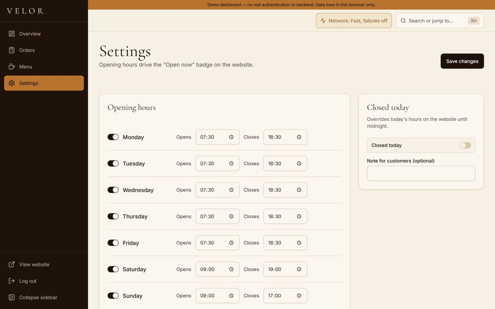 |

<p align="center">
  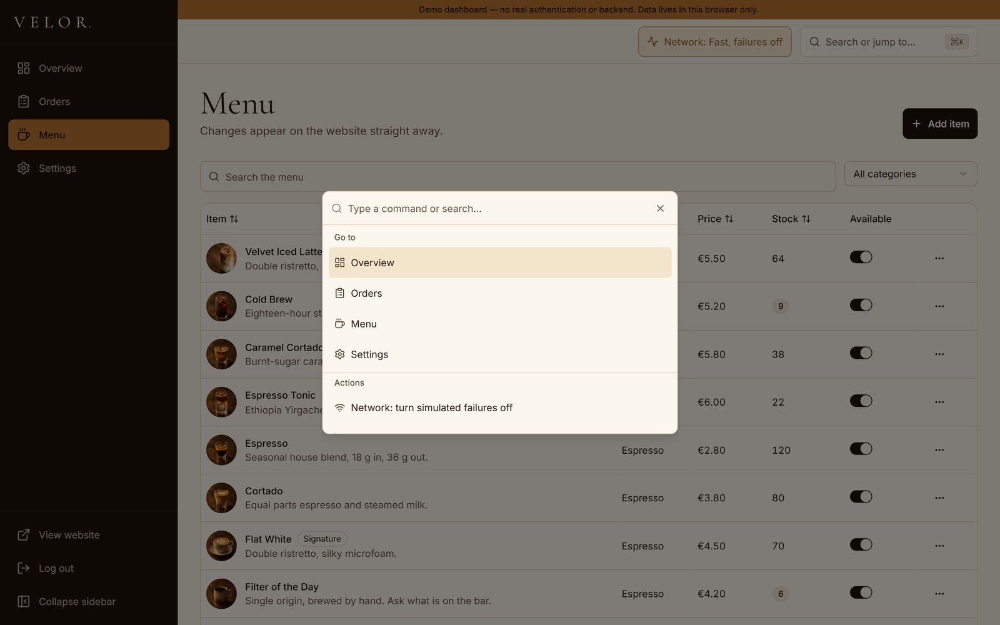<br>
  <sub>⌘K / Ctrl+K command palette</sub>
</p>

---

## Highlights

**Public site**
- **Scroll-scrubbed frame sequence**: a pinned canvas draws WebP frames tied 1:1 to scroll
  position. Frames are streamed progressively (first 30 at once, the rest when the browser
  is idle). The LCP element is a real `<picture>` poster, not the canvas.
- **Living hero**: preloader wordmark that glides into the nav (FLIP), slow breathing zoom,
  mouse parallax, drifting particles, a light sweep and a rotating badge.
- **Editorial sections**: marquee, dark "Our Story" with sticky column and counters, paper-style
  Menu with tabs and photo previews, pull quote, Visit footer with a live "Open now" badge (Paris time).
- **Glass nav** that tints to the section under it, hides on scroll down and shows reading progress.
- **Order ahead**: a pickup order form that posts to the API. Orders appear live on the admin board.

**Admin dashboard (`/admin`)**
- **Overview**: KPIs against the previous period, revenue over 7/30 days, orders by hour, best sellers, low stock.
- **Orders**: kanban (dnd-kit) with drag, full keyboard moves and a "Move to" menu, plus an incoming-order simulator.
- **Menu**: TanStack Table with search, sort and filters. Add/edit in a react-hook-form + zod side sheet.
- **Settings**: weekly hours, "Closed today" and a **network simulator**.
- ⌘K / Ctrl+K command palette.

**Production-grade data layer**
- Typed REST API (`/api/menu`, `/api/orders`, `/api/settings`) served by **MSW v2** in a service worker.
- **zod** schemas are the single source of truth for types, request validation (422 with field errors)
  and response validation.
- **TanStack Query**: caching, background refetch, polling of the order board every 15 s and
  cross-tab sync (BroadcastChannel) that invalidates queries.
- **Optimistic updates with rollback** for every admin write, with a failure toast and Retry.
- **Realistic network**: 300–900 ms latency, occasional failures and timeouts. The simulator
  switches between fast / normal / slow 3G and failures off / sometimes / always.
- **Idempotent order creation** (`Idempotency-Key` header), so a retry or double click never creates a duplicate.
- Skeleton loaders that reuse the real layout (CLS 0), error panels with Retry, and readable
  messages instead of raw error text.

**Quality**
- Accessibility: semantic HTML, keyboard support everywhere (including the kanban), polite live
  regions, 44 px touch targets, axe WCAG 2.1 AA scans with no violations on the admin pages.
- Reduced motion: no pinning, no scrubbing, no smooth scroll and no frame downloads. The beats stack as normal sections.
- Lighthouse (desktop, production build): Performance 97–98, Accessibility 100, Best Practices 100, SEO 100.
- The public page never loads the API client, MSW or TanStack Query. The admin never loads GSAP, Lenis or the frames.

---

## Tech stack

| Area | Tools |
|---|---|
| Framework | Next.js 15 (App Router, route groups), React 19, TypeScript strict |
| Styling | Tailwind CSS v4, shadcn/ui (admin) |
| Motion | GSAP, ScrollTrigger, SplitText, Lenis |
| Data | TanStack Query v5, Zustand (persisted), zod 4, MSW v2 |
| Admin UI | dnd-kit, TanStack Table, react-hook-form, Recharts |
| Tooling | ESLint, Playwright + axe-core (checks), Lighthouse |

---

## Architecture

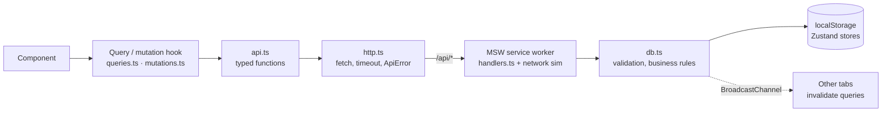

- **Components** never call `fetch`. They use query hooks (`src/lib/data/queries.ts`) and
  mutation hooks (`src/components/admin/mutations.ts`).
- **`api.ts`** is the only API surface: `getMenu`, `saveMenuItem`, `getOrders`, `createOrder`, …
- **`http.ts`** handles timeouts (8 s), error kinds (network, timeout, server, validation,
  not-found, invalid-response) and zod response validation.
- **MSW** is imported lazily, in the browser only, behind a ready gate (`ensureMocks()`), so the
  first request never races the worker. Unknown requests bypass it.

### Swapping MSW for a real backend

1. Implement the same endpoints (contracts in `src/lib/data/schemas.ts`) in any backend.
2. Remove the `ensureMocks()` call in `src/lib/data/http.ts` and point requests at your API base URL.
3. Delete `src/mocks/` and `public/mockServiceWorker.js`.

Components, hooks and `api.ts` stay as they are.

---

## Getting started

```bash
npm install
npm run dev          # http://localhost:3000 (regenerates the frame manifest first)
```

| Command | What it does |
|---|---|
| `npm run build` / `npm start` | Production build and server |
| `npm run lint` / `npm run typecheck` | ESLint / `tsc --noEmit` |

- Public site: `/`. Add `?debug` to see the live frame number.
- Dashboard: `/admin/login`.
- Reset demo data: clear the site's localStorage (`velor:*` keys).
- Service workers are blocked in some private windows. The admin then shows a clear startup message.

---

## Project structure

```
src/
  app/(site)/            public page (GSAP, Lenis, frames)
  app/(admin)/admin/     dashboard, own root layout and stylesheet
  components/            public sections, canvas sequence, hero motion, order form
  components/admin/      shell, board, table, forms, toasts, skeletons, mutations
  content/               all copy: site.ts, admin.ts, timeline.ts (scroll choreography)
  lib/data/              schemas, api, http client, queries, stores, sync, network sim
  mocks/                 MSW handlers, in-browser "database", network behaviour
public/frames/           WebP frame sequence (manifest generated at build)
public/menu/             menu photography
```

**Where to change things:** copy in `src/content/site.ts` and `src/content/admin.ts`, scroll
timing in `src/content/timeline.ts` (positions are frame numbers), colours and fonts in
`src/app/globals.css`, frame focal point in `src/lib/frames.ts`.

---

## Deploy (Vercel)

Import the repo in Vercel with the Next.js preset. No settings are needed. Frames are served with
long-lived immutable caching, and the mock worker with `no-store`. For a custom domain, set
`NEXT_PUBLIC_SITE_URL` (canonical, Open Graph and sitemap use it).

---

## About

Designed and built by [@siwar224](https://github.com/siwar224) as a frontend project. The brand, data and
orders are fictional. No payment is taken and nothing leaves the browser.
